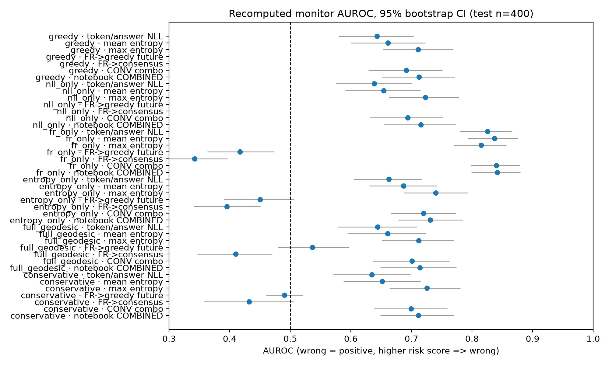
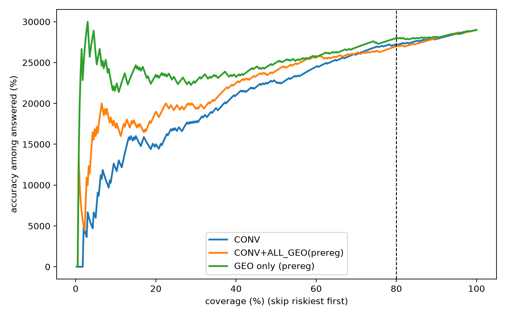
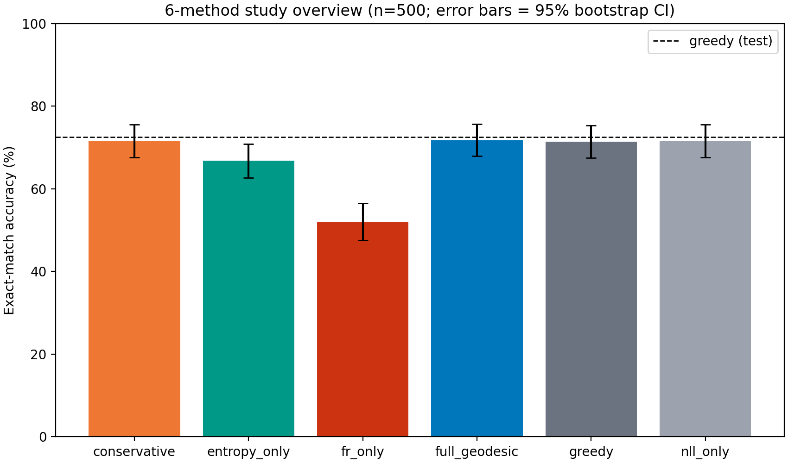
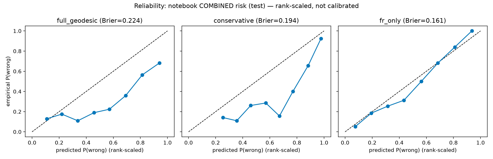

# Do geometry features help catch a language model's wrong answers?

**One-sentence answer from this study: on my test, no.**

I tested a fancy idea from math ("Fisher–Rao geometry") as a way to tell when
the model Qwen2.5-1.5B-Instruct gets a GSM8K math question wrong. The simple
features (how surprised the model is, how long its answer is) worked.
The geometry features added **zero** extra help.

I also show why an earlier version of this study looked much better
(AUROC ≈ 0.84) and why that number was a trap.

Everything here is open. Every number comes from a file you can check.

---

## New to this? Read this first (30 seconds)

- **A "monitor"** is a small helper model. It watches the big model and
  guesses: *right answer or wrong answer?*
- **AUROC** is a score from 0.0 to 1.0.
  - 0.5 = coin flip (useless).
  - 1.0 = perfect.
  - 0.77 = clearly useful but not perfect.
- **Entropy** = how unsure the model is about its next word. High = unsure.
- **NLL** (negative log-likelihood) = another word for "how surprised the
  model is". Low = confident.
- **Fisher–Rao (FR) distance** = a smart mathematical distance between two
  probability distributions. My question: does this smart distance see
  things that plain entropy cannot see?
- **Answer: no.** On this model and task: no.

---

## The results in one minute

I took 500 GSM8K questions. 100 for training the monitor, 400 kept away for
testing (untouched, frozen, never peeked at while building).

| Monitor | AUROC on 400 test questions | What it means |
|---|---|---|
| Simple: entropy + NLL + answer length | **0.770** (CI 0.713 – 0.821) | Best. Simple features win. |
| Simple + all 6 geometry features | 0.728 | Geometry made it **worse**. |
| Geometry features only | 0.661 | Some signal, but weaker than simple. |

More results, with all 8 statistical tests: one exploratory (not
pre-registered) arm, CONV+max_frcons, scored 0.775 — that is only +0.005 and
it is not statistically significant. Nothing else got even +0.005.

### The main chart

*Every monitor tested. The dashed line at 0.5 = coin flip. Higher = better.
The best simple setup sits near 0.77; the geometry-only setups sit lower.*



### What "skipping hard questions" looks like

If the monitor is good, you can skip the questions it marks as risky and the
questions you do answer become more accurate. Here is that trade-off.
At the 80% line (answer 80% of questions), the simple monitor and the
geometry monitor are close to each other or the simple one is better.



### The trap: what the old ≈0.84 number really was

In my first run, one decoding arm accidentally made the model much weaker
(52% accuracy instead of 72%). In that broken regime, simple features looked
amazing (AUROC ≈ 0.84). But that was a feature of the broken regime, not a
feature of the geometry method. I show the pieces of this mistake
step-by-step in the paper. This chart shows how much worse the weak arm was:



*The red bar (`fr_only`, 52%) is the accidentally weak decoding arm.
Everything else is ~72%.*

### Honesty chart: my monitor scores are ranks, not probabilities

The monitors output a risk score. I scale it to 0–1 for plots. It is a
*ranking*, not a calibrated probability. This is stated everywhere.



---

## Why you can trust these numbers

- Frozen test set. I never tuned anything on it.
- I wrote the pass/fail rules **before** looking at the run-2 results.
- Decoding is fully deterministic. Re-running gives byte-identical outputs
  (I checked, via md5, across two separate GPU sessions).
- I found **four bugs in my own analysis**. I fixed them, and I published
  the wrong version *and* the fixed version, so you can see the difference.
- Independent checks with sklearn matched my own code exactly (0.0
  difference) on every monitor.
- Two previous headline claims from this project were themselves wrong — the
  README you are reading now is the corrected story.

## Where this sits in the literature

I searched arXiv (cs.CL) on 2026-10-17. Nobody I found tests
"Fisher–Rao distance between candidate futures" as a monitor feature the way
this study does. But Fisher–Rao geometry **is** used in other LLM roles —
most importantly, a concurrent preprint (Belief-Trajectory Energy,
arXiv:2610.05114) shows Fisher–Rao structure in layer-wise belief updates
predicts errors. My null result is about *token-level candidate divergence
features*, a different point in the pipeline. The paper's §3 and the
References list every source with its verified DOI or arXiv ID.

---

## Run it yourself

You need Python 3.11+ and about 16 GB of RAM.

```bash
pip install -r requirements.txt
```

**Important:** two raw data folders are too big for GitHub, so first
(optional, only if you want the full raw data):
```bash
kaggle kernels output pikanigga/geodesic-run-2-full -p kaggle_out/full
```

Then rebuild every table and figure of the main analysis:
```bash
python analysis/run2_analysis.py --indir kaggle_out/full/geodesic_study2 --outdir analysis/outputs2
```

You should get the exact numbers above (seed 42, deterministic). The small
score tables (`analysis/outputs2/*.csv`) **are** in this repo, so you can
verify against them without downloading anything.

To redo the *GPU generation* part, use the Kaggle notebooks in `kernels/`
(cost: about 15-19 T4-hours; a 2-question smoke costs ~2 minutes).

---

## What is in this repo

| Folder / file | What it is |
|---|---|
| `notebooks/geodesic_study.ipynb` | The main notebook (3 cells: run-1 study, run-1 fix, run-2 monitor). |
| `analysis/` | All analysis code + small result CSVs + figures. |
| `kernels/` | Kaggle notebook sources for the 2x-T4 GPU runs. |
| `geodesic_study/` | Run-1 raw results (big CSVs excluded, see above). |
| `kaggle_out/` | Run-2 raw results (excluded from git; download command above). |
| `docs/` | The reports: audit, run-2 report, frozen protocol. |
| `paper/` | The paper draft, the audit checklist, a review-style report. |
| `experiment/` | A written plan (not yet approved) to repeat on Qwen2.5-3B. |

## Suggested reading order

1. This README.
2. `docs/run2_report.md` — full run-2 story.
3. `paper/paper_draft.md` — the paper with all numbers and caveats.
4. `paper/audit_checklist.md` — every check I ran, evidence per line.
5. `experiment/replication_protocol.md` — the not-yet-run 3B plan.

## Known limits (please read)

- One model (1.5B), one dataset (GSM8K), bf16. Results do not automatically
  extend to other models or tasks.
- Lookahead is one token. Longer lookahead: untested.
- With 400 test questions, my confidence intervals can rule out geometry
  gains bigger than about +0.04 AUROC. Gains smaller than that: possible,
  I cannot see them.
- The monitors use one score per question. Step-level sequence models might
  behave differently. Untested.
- The replication plan is written but **not run**.

## Credits & license

- Model: Qwen2.5-1.5B-Instruct (Apache-2.0, Alibaba Qwen team).
- Dataset: GSM8K (Cobbe et al., 2021).
- Compute: free Kaggle notebook GPUs (2x T4).
- License: MIT (see `LICENSE`). Cite via `CITATION.cff`.

If this repo saved you from believing a *confounded* AUROC — that was the
point. Negative results, done carefully, are still science.
