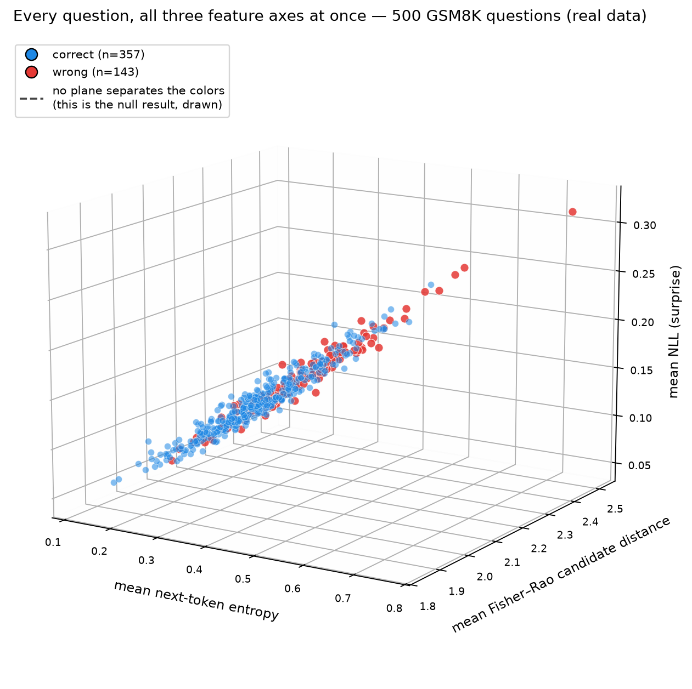

# Do geometry features help catch a language model's wrong answers?

**One-sentence answer from this study: on my test, no.**

I tested a fancy idea from math ("Fisher–Rao geometry") as a way to tell when
the model Qwen2.5-1.5B-Instruct gets a GSM8K math question wrong. The simple
features (how surprised the model is, how long its answer is) worked.
The geometry features added **zero** extra help.

I also show why an earlier version of this study looked much better
(AUROC ≈ 0.84) and why that number was a trap.

Everything here is open. Every number comes from a file you can check.

---

## The full story — how this project got here

**Chapter 1 — The first experiment (run 1).** I built an experiment to answer
one question: can a model answer math questions *better* if it peeks one
token ahead, using Fisher–Rao geometry between "possible futures"?
I decoded 500 GSM8K questions in 6 different ways, saved every token, and
built small monitor models to predict wrong answers.

**Chapter 2 — The "what?!" moment.** One monitor score came out very high,
around **0.84 AUROC**. For these tasks that felt almost too good. It was.
I was suspicious of my own best result, and that suspicion is the only reason
this project is worth reading.

**Chapter 3 — I audited myself like an enemy.** I wrote independent check
scripts (`analysis/audit_raw_A1A4.py`) that only re-measured things. I found
that one decoding arm had quietly **broken the model** (52% accuracy instead
of ~72%). With so many extra wrong answers, the monitor learned an easy rule
— "if the model is confused, it's wrong" — and the 0.84 measured the broken
regime, not the geometry method. I also found real bugs in my own analysis
code along the way (six in total, all documented).

**Chapter 4 — Freeze the rules first.** I wrote a pre-registration
(`docs/experiment_protocol.md`): fixed split, fixed decoding, fixed monitors,
and pass/fail criteria written **before** looking at any new result.

**Chapter 5 — The clean run (run 2).** I re-ran everything on free Kaggle
GPUs (2x T4): 519,356 candidate rows, all 500 questions, zero failures.
Decoding was fully deterministic — the outputs were byte-identical across two
separate GPU sessions (checked with md5).

**Chapter 6 — The verdict.** Every pre-registered geometry arm failed to
improve AUROC (all point estimates ≤ 0; one unregistered, exploratory arm
gained +0.005 and is not statistically significant). The honest number is
**0.770** for simple features.
The geometry features carry *some* signal alone (0.661), but nothing that
survives once entropy, NLL, and length are known. Both the wrong versions and
the fixed versions of my analysis are kept in this repo, so you can check
every step yourself.

---

## What I got out of this project

**Scientific findings:**

1. **Fisher–Rao candidate-future features add nothing** to entropy/NLL/length
   monitors on this model and task. Every pre-registered arm scored ≤ 0
   ΔAUROC; the only positive point estimate (+0.005) was an unregistered
   exploratory arm and is not significant.
2. **The honest monitor level is AUROC ≈ 0.77** on 400 frozen test questions.
3. **The famous-looking 0.84 was a regime confound** — I decomposed it fully
   (52% decoding arm, higher wrong-answer rate, simple features doing all the
   work) and can now tell that story with numbers.
4. **Fisher–Rao features are not useless**, but they are **mostly redundant**:
   alone 0.661 AUROC, yet overlapping with entropy (dev-set Spearman ρ = 0.51
   with mean next-entropy; −0.63 for the FR spread feature).

**Engineering outcomes:**

1. **A fully deterministic pipeline** — same inputs, same bytes out, verified
   across independent GPU sessions. Rare in LLM research and worth copying.
2. **A reusable audit framework** — raw-data checks (A1–A4), metric
   cross-checks vs sklearn, a written mapping of every claim to the CSV that
   backs it, and a line-by-line audit checklist.
3. **Six self-found defects** (D1–D6), each fixed, disclosed, and versioned —
   including one plotting bug found only while rebuilding this README.
4. **A pre-registered protocol** and a ready-to-run replication plan on a
   bigger model (Qwen2.5-3B), waiting for approval.
5. All artifacts: ~35 result tables (CSV), 6 figures, raw logs, kernel
   sources - everything regenerable from the commands in this README.

**What I still don't know (my open bets):** bigger model? different look-ahead?
step-sequence monitors? The written-but-unrun 3B plan (`experiment/`) is my
next test.

---

## New to this? Read this first (30 seconds)

- **A "monitor"** is a small helper model. It watches the big model and
  guesses: *right answer or wrong answer?*
- **AUROC** is a score from 0.0 to 1.0.
  - 0.5 = coin flip (useless).
  - 1.0 = perfect.
  - 0.77 = clearly useful but not perfect.
- **Entropy** = how unsure the model is about its next word. High = unsure.
- **NLL** (negative log-likelihood) = another word for "how surprised the
  model is". Low = confident.
- **Fisher–Rao (FR) distance** = a smart mathematical distance between two
  probability distributions. My question: does this smart distance see
  things that plain entropy cannot see?
- **Answer: no.** On this model and task: no.

---

## The results in one minute

I took 500 GSM8K questions. 100 for training the monitor, 400 kept away for
testing (untouched, frozen, never peeked at while building).

| Monitor | AUROC on 400 test questions | What it means |
|---|---|---|
| Simple: entropy + NLL + answer length | **0.770** (CI 0.713 – 0.821) | Best. Simple features win. |
| Simple + all 6 geometry features | 0.728 | Geometry made it **worse**. |
| Geometry features only | 0.661 | Some signal, but weaker than simple. |

More results, with all 8 statistical tests: one exploratory (not
pre-registered) arm, CONV+max_frcons, scored 0.775 — that is only +0.005 and
it is not statistically significant. Nothing else got even +0.005.

### The main chart

*Every monitor tested. The dashed line at 0.5 = coin flip. Higher = better.
The best simple setup sits near 0.77; the geometry-only setups sit lower.*


### All 500 questions in one 3D picture

This is the whole study in one image, drawn from the real per-question data (no
statistics, just the raw points). Every dot is one GSM8K question. Blue =
the model answered it correctly, red = wrong. If geometry "saw" something
entropy cannot see, red and blue would separate in some rotation of this
cloud. They don't. That is the null result, drawn.



### What "skipping hard questions" looks like

If the monitor is good, you can skip the questions it marks as risky and the
questions you do answer become more accurate. Here is that trade-off.
At the 80% line (answer 80% of questions), the simple monitor and the
geometry monitor are close to each other or the simple one is better.


### The trap: what the old ≈0.84 number really was

In my first run, one decoding arm accidentally made the model much weaker
(52% accuracy instead of 72%). In that broken regime, simple features looked
amazing (AUROC ≈ 0.84). But that was a feature of the broken regime, not a
feature of the geometry method. I show the pieces of this mistake
step-by-step in the docs. This chart shows how much worse the weak arm was:


*The red bar (`fr_only`, 52%) is the accidentally weak decoding arm.
Everything else is ~72%.*

### Honesty chart: my monitor scores are ranks, not probabilities

The monitors output a risk score. I scale it to 0–1 for plots. It is a
*ranking*, not a calibrated probability. This is stated everywhere.


---

## Why you can trust these numbers

- Frozen test set. I never tuned anything on it.
- I wrote the pass/fail rules **before** looking at the run-2 results.
- Decoding is fully deterministic. Re-running gives byte-identical outputs
  (I checked, via md5, across two separate GPU sessions).
- I found **six bugs in my own analysis**. I fixed them, and I published
  the wrong version *and* the fixed version, so you can see the difference.
- Independent checks with sklearn matched my own code exactly (0.0
  difference) on every monitor.
- Two previous headline claims from this project were themselves wrong — the
  README you are reading now is the corrected story.

---

## Run it yourself

You need Python 3.11+ and about 16 GB of RAM.

```bash
pip install -r requirements.txt
```

**Important:** two raw data folders are too big for GitHub, so first
(optional, only if you want the full raw data):
```bash
kaggle kernels output pikanigga/geodesic-run-2-full -p kaggle_out/full
```

Then rebuild every table and figure of the main analysis:
```bash
python analysis/run2_analysis.py --indir kaggle_out/full/geodesic_study2 --outdir analysis/outputs2
python analysis/make_3d_figure.py
```

You should get the exact numbers above (seed 42, deterministic). The small
score tables (`analysis/outputs2/*.csv`) **are** in this repo, so you can
verify against them without downloading anything.

To redo the *GPU generation* part, use the Kaggle notebooks in `kernels/`
(cost: about 15-19 T4-hours; a 2-question smoke costs ~2 minutes).

---

## What is in this repo

| Folder / file | What it is |
|---|---|
| `notebooks/geodesic_study.ipynb` | The main notebook (3 cells: run-1 study, run-1 fix, run-2 monitor). |
| `analysis/` | All analysis code + small result CSVs + figures. |
| `kernels/` | Kaggle notebook sources for the 2x-T4 GPU runs. |
| `geodesic_study/` | Run-1 raw results (big CSVs excluded, see above). |
| `kaggle_out/` | Run-2 raw results (excluded from git; download command above). |
| `docs/` | The reports: audit, run-2 report, frozen protocol. |
| `experiment/` | A written plan (not yet approved) to repeat on Qwen2.5-3B. |

## Suggested reading order

1. This README.
2. `docs/run2_report.md` — the full run-2 story.
3. `docs/audit_phase1.md` — how the first experiment was audited, line by line,
   with the version ledger of all six defects.
4. `docs/experiment_protocol.md` — the frozen rules.
5. `experiment/replication_protocol.md` — the not-yet-run 3B plan.

## Known limits (please read)

- One model (1.5B), one dataset (GSM8K), bf16. Results do not automatically
  extend to other models or tasks.
- Lookahead is one token. Longer lookahead: untested.
- With 400 test questions, my confidence intervals can rule out geometry
  gains bigger than about +0.04 AUROC. Gains smaller than that: possible,
  I cannot see them.
- The monitors use one score per question. Step-level sequence models might
  behave differently. Untested.
- The replication plan is written but **not run**.

## Credits & license

- Model: Qwen2.5-1.5B-Instruct (Apache-2.0, Alibaba Qwen team).
- Dataset: GSM8K (Cobbe et al., 2021).
- Compute: free Kaggle notebook GPUs (2x T4).
- License: MIT (see `LICENSE`). Cite via `CITATION.cff`.

If this repo saved you from believing a *confounded* AUROC — that was the
point. Negative results, done carefully, are still science.
